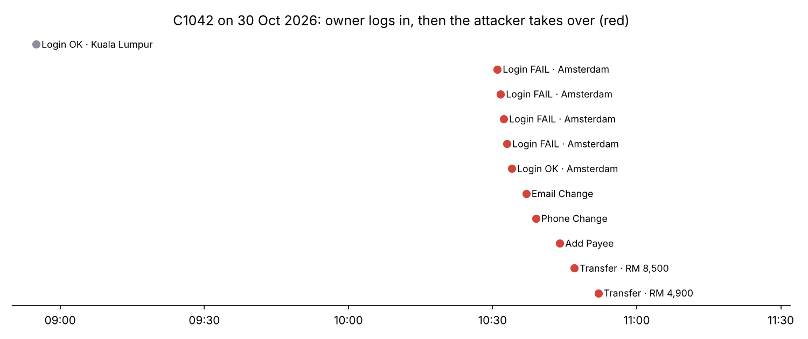
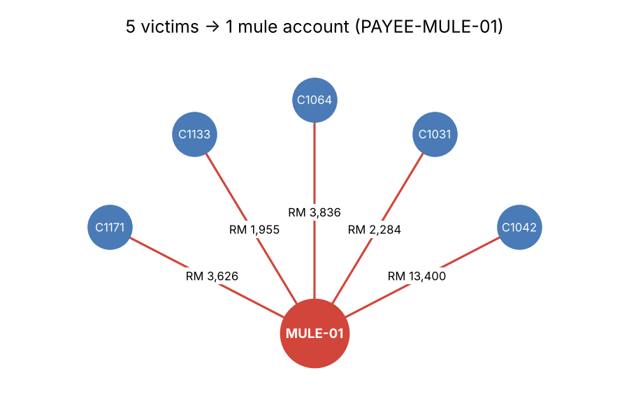
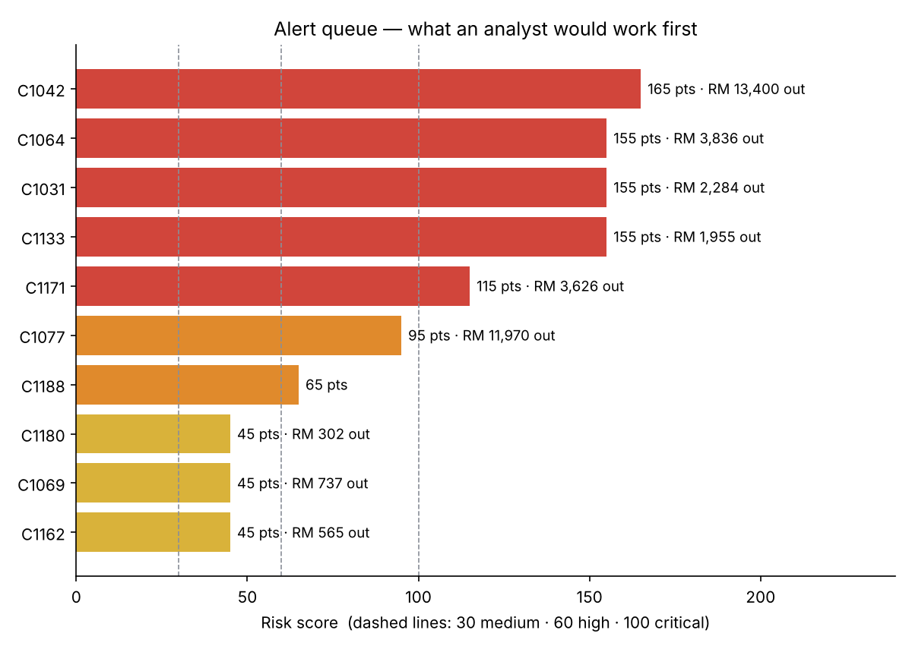

# Fraud → Cybersecurity: Account Takeover (ATO) Detection

**Objective.** Show how the way I worked as a **fraud analyst** maps directly onto **SOC threat detection**, using one shared problem: criminals logging in to customers' accounts and moving money out.

I built 8 detection rules (7 in **SQL**, 1 in **Python**), combined them into a **risk score** like a fraud rule engine, and produced a prioritised alert queue.

**Certification link:** Security Core (SCOR) — Secure Network Access, Visibility & Enforcement, Phishing · CCNP Security — Access Solutions, ISE (identity, context-aware access)

## 🔄 Fraud analyst ↔ SOC analyst — same job, different words
| In fraud, I did… | In a SOC, it's called… | In this project |
| --- | --- | --- |
| Transaction monitoring | SIEM monitoring | Login + account-event logs |
| Fraud rules (velocity, amount, new beneficiary) | Correlation / detection rules | `detections.sql` |
| Rule scoring → case priority | Alert severity / risk-based alerting | Risk score + priority |
| Customer profile ("is this normal for **them**?") | User behaviour analytics (UEBA) | New device, new country, travel speed |
| Velocity checks | Rate / threshold rules | Failed logins before success |
| Linking accounts to one mule | Threat hunting / pivoting on an indicator | Shared payee rule |
| Account freeze, reverse transfer | Containment | Recommended response |
| False-positive tuning | Detection engineering | "Tuning" section below |
| Case notes / SAR | Incident report | This README |

## TL;DR
| Priority | Customer(s) | What happened | Money out |
| --- | --- | --- | --- |
| 🔴 CRITICAL | C1042 | Attacker in **Amsterdam** logged in 1.6 h after the owner in **KL** (6,176 km/h), guessed OTP 4×, then changed **email → phone → added payee → 2 transfers** — all in **18 minutes** | RM 13,400 |
| 🔴 CRITICAL | C1031, C1064, C1133, C1171 | New devices from **Lagos**, each added the **same payee** `PAYEE-MULE-01` as C1042 and sent money | RM 11,701 |
| 🟠 HIGH | C1077 | 3 failed logins at **2 am from Vietnam** → password reset → **new shipping address** → RM 11,200 phone order | RM 11,200 |
| 🟠 HIGH | C1188 | **Phone number changed**, 18 min later a new device logs in and adds a payee → SIM-swap pattern. **No money out yet** — the best time to stop it | RM 0 |
| 🟡 MEDIUM | C1069, C1162, C1180 | Small transfers to **existing** payees from a second device at home — **likely false positives** (see Tuning) | — |

**About RM 36,300 stolen across 6 accounts, through 1 mule account.**

> 💡 **Key lesson:** no single rule catches everything.
> - **Impossible travel** missed C1171 — the attacker waited 36 hours, so the "trip" looked possible.
> - **Shared payee** caught C1171 anyway, because the money went to the **same mule** as the others.
> - Layered rules + scoring = what fraud teams already do. SOCs call it **defence in depth**.

## Dataset (synthetic)
| File | Rows | Fields |
| --- | --- | --- |
| [`data/logins.csv`](./data/logins.csv) | 4,021 | ts, customer_id, ip, country, city, lat, lon, device_id, result, mfa |
| [`data/account_events.csv`](./data/account_events.csv) | 997 | ts, customer_id, event_type, detail, amount_myr |

200 customers of a Malaysian online bank / e-wallet, 20 Oct – 2 Nov 2026. Built with [`generate_data.py`](./generate_data.py). IPs are documentation ranges, not real addresses.  
It also hides **"scary but innocent"** cases on purpose: a JB customer popping into Singapore, a KL customer flying to Tokyo (9 h, 580 km/h — a plane), and someone with a new phone.

## The 8 rules
| # | Rule | Points | Why it matters | Written in |
| --- | --- | --- | --- | --- |
| 1 | **Impossible travel** (> 900 km/h, > 500 km) | 40 | Same person can't be in KL and Amsterdam 1.6 h apart | Python (haversine) |
| 2 | **Money out < 60 min after new-device login** | 30 | Cash-out is the goal of ATO | SQL |
| 3 | **Same new payee added by 3+ customers** | 30 | Points to a mule account | SQL |
| 4 | **Profile change < 60 min after new-device login** | 25 | Attackers lock the owner out (email/phone) before cash-out | SQL |
| 5 | **SIM swap:** phone change → new device < 60 min | 25 | Steals OTPs | SQL |
| 6 | New device (after 3+ days of history) | 15 | Weak alone — people change phones | SQL |
| 7 | New country | 15 | Weak alone — people travel | SQL |
| 8 | 3+ failed logins in 10 min, then success | 10 | Guessing password or OTP | SQL |

**Priority:** ≥ 100 🔴 CRITICAL · 60–99 🟠 HIGH · 30–59 🟡 MEDIUM · < 30 no alert

Run it yourself:
```bash
pip install pandas matplotlib
python analyze.py
```

## Findings

### 1. 🔴 C1042 — full takeover in 18 minutes

- **08:55** owner logs in from KL on their usual phone (grey).
- **10:31–10:33** 4 failed attempts from Amsterdam on a new device → **10:34 success** (OTP guessed or phished).
- **10:37 email changed → 10:39 phone changed** → the owner won't get alerts or OTPs any more.
- **10:44 new payee → 10:47 & 10:52 transfers** (RM 8,500 + RM 4,900).
- Rules hit: **7 of 8**. Score 165.

### 2. 🔴 Mule account linking 5 victims

- `PAYEE-MULE-01` received money from **5 different customers** in under 4 days.
- **Fraud skill → cyber value:** pivoting on one shared indicator (a payee, an IP, a device) turns 5 separate alerts into **one campaign** — and the mule account can be frozen to protect future victims.

### 3. 🟠 C1077 — e-commerce style takeover
- 2 am, Vietnam, 3 fails → password reset → **new delivery address** → RM 11,200 order for 2 smartphones.
- Classic e-commerce fraud pattern: change **where the goods go**, then buy items that are easy to resell.

### 4. 🟠 C1188 — SIM swap caught before cash-out
- Phone change, then a new device 18 min later adds a payee. **No transfer yet.**
- Best action: **hold** new payees for this account and call the customer on a **verified old number** or in branch.

### 5. 🟡 Tuning — 3 likely false positives

- C1069, C1162, C1180: second device, **home city**, small transfers to **existing** payees.
- **Tuning idea:** only score rule 2 when the transfer goes to a payee added **in the same session**, or is above RM 1,000. That removes all 3 without losing any real case.
- Not alerted at all (correctly): the Singapore day trip, the Tokyo flight, the new phone. 🎯

## Recommended Response
1. **CRITICAL accounts:** freeze outgoing transfers, end all sessions, restore the original email/phone, contact customer by a verified channel.
2. **Mule account:** freeze `PAYEE-MULE-01`, request funds recall from the receiving bank, report (in Malaysia: National Scam Response Centre 997 / police report).
3. **C1077:** cancel the order before shipping, reset credentials.
4. **C1188:** hold new payees, verify with customer, check with the telco about the SIM change.
5. **Prevention:** require step-up authentication (app-based approval, not SMS OTP) for email/phone changes and new payees; add a **cooling-off period** before a new payee can receive large amounts.

## Detection ideas (Splunk, conceptual)
**Change before cash-out:**
```splunk
index=app (event_type=EMAIL_CHANGE OR event_type=PHONE_CHANGE OR event_type=ADD_PAYEE OR event_type=TRANSFER)
| transaction customer_id maxspan=60m
| where mvcount(event_type)>=3 AND like(event_type,"%TRANSFER%")
```

**Shared payee across customers:**
```splunk
index=app event_type=ADD_PAYEE earliest=-7d
| stats dc(customer_id) as victims values(customer_id) as customers by detail
| where victims>=3
```

---

# 🔁 Redo it yourself (step by step)

**You need:** Python 3, and [DB Browser for SQLite](https://sqlitebrowser.org/) (free) for the SQL part. **Time:** ~2.5 hours.

### Part A — Know the data (20 min)
- [ ] Open both CSVs in Excel
- [ ] Filter `account_events` for `customer_id = C1042`. Read the story row by row
- [ ] Do the same in `logins`. Find the moment the city changes
- 🧠 **Understand:** this is exactly a fraud case review — just with login data added

### Part B — SQL rules (1 h)
- [ ] DB Browser → New Database → **File → Import → Table from CSV** → import both files (table names: `logins`, `account_events`)
- [ ] Open `detections.sql`. Copy **one** block (from `-- name:` to the `;`) into "Execute SQL" and run it
- [ ] Do this for all 7 blocks. For each, write one sentence: *"This finds… because…"*
- [ ] Change one threshold (e.g. `>= 3` fails → `>= 2`). What new rows appear? Are they real attacks?
- 🧠 **Key SQL ideas:**
  - `MIN(ts) ... GROUP BY customer_id, device_id` = **first time seen** (the heart of "new device")
  - `julianday(a) - julianday(b)` = difference in **days**. × 24 × 60 = **minutes**
  - `HAVING COUNT(DISTINCT customer_id) >= 3` = filter **after** grouping

### Part C — Python: travel + scoring (45 min)
- [ ] Run `python analyze.py`
- [ ] Find `km_between()` — this is the haversine formula (distance on a sphere). Test it: KL → Singapore should be ~ 300 km
- [ ] Find `POINTS` — change `new_country` to `40`. Run again. Who now becomes an alert? (Hint: the Tokyo traveller.) Why is that bad?
- [ ] Implement the **tuning idea** from Finding 5 in `detections.sql` and rerun — the 3 MEDIUM alerts should disappear
- 🧠 **Understand:** points = how much you **trust** each signal. Weak signals only matter **together**

### Part D — Make it yours (optional)
- [ ] Build the alert queue as a **Power BI** dashboard from the output
- [ ] Add a rule: login with `mfa = NONE` that still succeeds
- [ ] Write a 1-page "incident report" for C1042 like you would for a fraud case

### Finish
- [ ] Write "What I learned" — especially what felt **the same** as your fraud work

## What I learned
- *(write yours here)*

## Files
| File | What it is |
| --- | --- |
| [`detections.sql`](./detections.sql) | 7 SQL detection rules |
| [`analyze.py`](./analyze.py) | Runs the SQL, impossible travel, risk scoring, charts |
| [`generate_data.py`](./generate_data.py) | Builds the synthetic dataset |
| [`data/`](./data) | Synthetic logins + account events |
| [`img/`](./img) | Output charts |
