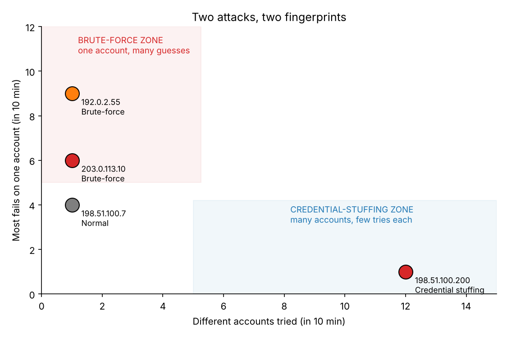
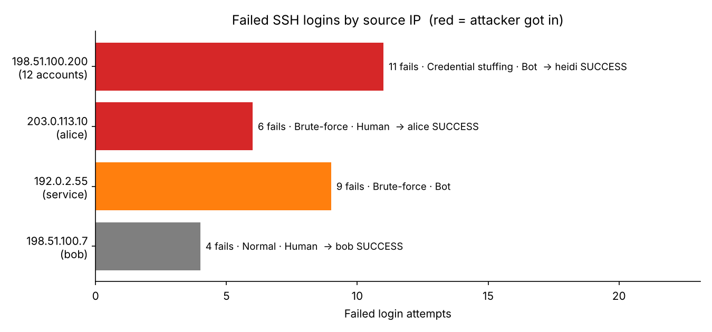
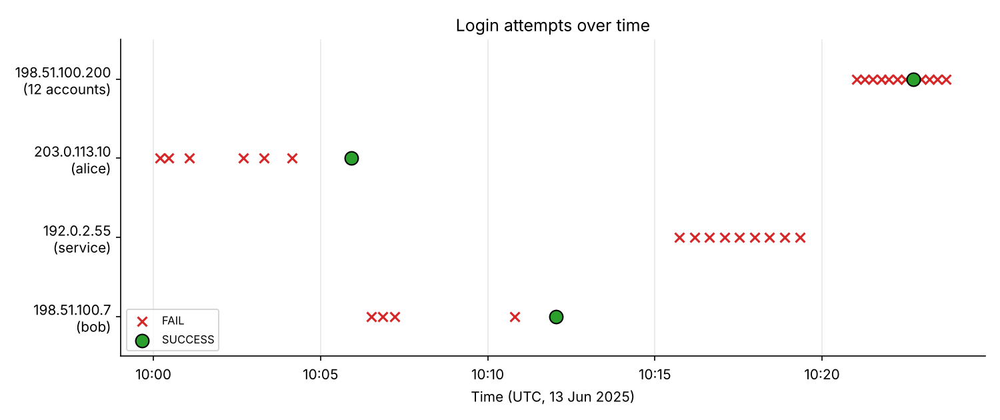

# Log Analysis – Brute-Force & Credential-Stuffing Detection (SIEM Simulation)

**Objective.** Show how stolen or guessed passwords turn into account break-ins — and how to spot it in login logs using Python.

## 🇲🇾 Why this matters
- In Nov 2026, the Prime Minister told Parliament that Malaysia could be a target of sophisticated cyberattacks, and Bank Negara arranged a special session with financial institutions. ([Malay Mail](https://www.malaymail.com/amp/news/malaysia/2026/11/03/pm-anwar-malaysia-vulnerable-to-sophisticated-cyber-attacks-home-ministry-to-hold-special-meeting-today/241783))
- **Nacsa** has reported more incidents using **stolen usernames and passwords**, noting the technique needs little skill, and expects **credential theft to rise in 2026**. ([FMT](https://www.freemalaysiatoday.com/category/nation/2024/03/22/more-cyber-attacks-through-stolen-logins-taking-place-says-agency), [The Star](https://www.thestar.com.my/tech/tech-news/2026/03/23/cyber-incidents-rise-as-malaysians-lag-on-online-safety))
- **553,722 Malaysian accounts** were exposed in public data leaks in 2025, and Cyber999 logged **5,735 incident reports** in the first nine months of 2025. ([The Star](https://www.thestar.com.my/tech/tech-news/2026/03/23/cyber-incidents-rise-as-malaysians-lag-on-online-safety))

Leaked or weak passwords don't hurt anyone until someone **uses them at a login page**. That moment leaves traces in the logs. This project finds them.

## Two attacks, two fingerprints
| | 🔨 Brute-force | 🔑 Credential stuffing |
| --- | --- | --- |
| **Idea** | Guess the password for **one** account | Try **leaked** username/password pairs on **many** accounts |
| **In the logs** | Many fails on the **same user** | **Many different users**, 1 try each |
| **Easy to miss because…** | — | Each account only fails once, so per-account alerts never fire |

## TL;DR
| Risk | Source IP | Attack | Accounts | What happened | Action |
| --- | --- | --- | --- | --- | --- |
| 🔴 **HIGH** | `198.51.100.200` | Credential stuffing (bot) | 12 | Tried 12 accounts in under 3 min → **heidi logged in on the first try** | Reset heidi, block IP, check other accounts for reused passwords |
| 🔴 **HIGH** | `203.0.113.10` | Brute-force | alice | 6 fails in ~4 min → **SUCCESS** | Reset alice, end sessions, review activity |
| 🟠 **MEDIUM** | `192.0.2.55` | Brute-force (bot) | service | 9 fails, **exactly 27 sec apart** → no success | Block IP, harden service account |
| ⚪ **LOW** | `198.51.100.7` | Normal | bob | 4 fails, irregular timing → success | Likely forgotten password; confirm with user |

## Dataset
Synthetic SSH auth logs: [`data/logs.csv`](./data/logs.csv) — 33 events, 4 source IPs, 13 Jun 2025 10:00–10:24 UTC  
Fields: `timestamp, user, src_ip, action, protocol`  
IPs are from reserved documentation ranges (RFC 5737), not real addresses.

## Method — 4 checks per source IP (10-minute window)
| # | Check | Catches | Rule |
| --- | --- | --- | --- |
| 1 | Most fails on **one** account | Brute-force | ≥ 5 |
| 2 | Number of **different** accounts tried | Credential stuffing | ≥ 5 |
| 3 | A **SUCCESS** after the failures? | Compromise | yes / no |
| 4 | How **regular** is the timing? (std dev of gaps) | Bot vs human | ≤ 5 sec = bot |

**Risk:** attack + success = 🔴 HIGH · attack, no success = 🟠 MEDIUM · no attack but success = ⚪ LOW

Run it yourself:
```bash
pip install pandas matplotlib
python analyze.py
```

## Findings

### 1. 🔴 198.51.100.200 → 12 accounts — credential stuffing, heidi compromised
- One IP tried **12 different accounts in 2 min 40 s**, one attempt each, about **every 15 seconds** (gap std dev 0.5 s → a script).
- **heidi's login succeeded on the first try.** The attacker already had her password — most likely from a leak or reuse on another site.
- ⚠️ **A "5 fails per account" rule would never catch this.** heidi had zero failed logins. Only checking *how many accounts one IP touches* reveals it.

### 2. 🔴 203.0.113.10 → alice — brute-force, alice compromised
- 6 failed logins between 10:00:12 and 10:04:09, then **SUCCESS at 10:05:55**.
- Crosses the threshold **and** ends in success — the classic guess-until-it-works pattern.

### 3. 🟠 192.0.2.55 → service — automated brute-force, not (yet) successful
- 9 fails in 3.5 minutes, **exactly 27 seconds apart** (std dev = 0) → a bot.
- Targets a **service account**, which often has weak or shared passwords and no MFA.

### 4. ⚪ 198.51.100.7 → bob — likely benign
- 3 quick fails, a 3.5-minute pause, 1 more fail, then success. **Below the threshold** and irregular — looks like a person remembering their password.

> 💡 **Lesson: volume isn't risk.** The noisiest single-account attacker (`192.0.2.55`, 9 fails) never got in. The two that did got in quietly — one with only 6 tries, the other with **zero** failures on the stolen account. It's the same lesson from fraud detection: one *successful* fraudulent transaction matters more than ten declined ones.

## Charts
**Two attack types sit in two different corners:**


**Failed logins by source IP (red = attacker got in):**


**Every login attempt over time — note the evenly spaced bot patterns:**


## Recommended Response
1. **heidi & alice:** force password resets, end active sessions, review activity after the successful login.
2. **Credential stuffing:** check whether other users share leaked or reused passwords; turn on **MFA** — a leaked password alone is then not enough.
3. **Block** `198.51.100.200` and `192.0.2.55`; add rate-limiting (e.g. fail2ban) on SSH.
4. **Service account:** switch to key-based SSH auth and disable password login.
5. **bob:** confirm the login was his.

## Detection Ideas (SOC-style)
**Brute-force — many fails on one account (Splunk, conceptual):**
```splunk
index=auth action=FAIL
| bin _time span=10m
| stats count by src_ip, user, _time
| where count>=5
```

**Credential stuffing — one IP, many accounts:**
```splunk
index=auth
| bin _time span=10m
| stats dc(user) as accounts, count(eval(action="SUCCESS")) as successes by src_ip, _time
| where accounts>=5
```

**Attack followed by success:**
```splunk
index=auth
| stats count(eval(action="FAIL")) as fails,
        count(eval(action="SUCCESS")) as successes,
        dc(user) as accounts by src_ip
| where (fails>=5 OR accounts>=5) AND successes>0
```

## Files
| File | What it is |
| --- | --- |
| [`analyze.py`](./analyze.py) | Detection logic (4 checks) + chart generation |
| [`data/logs.csv`](./data/logs.csv) | Synthetic auth logs |
| [`img/`](./img) | Output charts |
