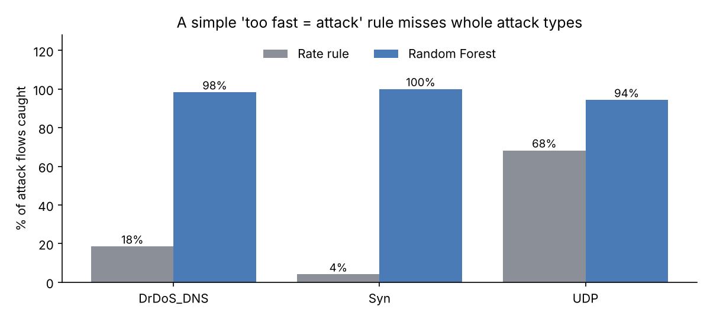
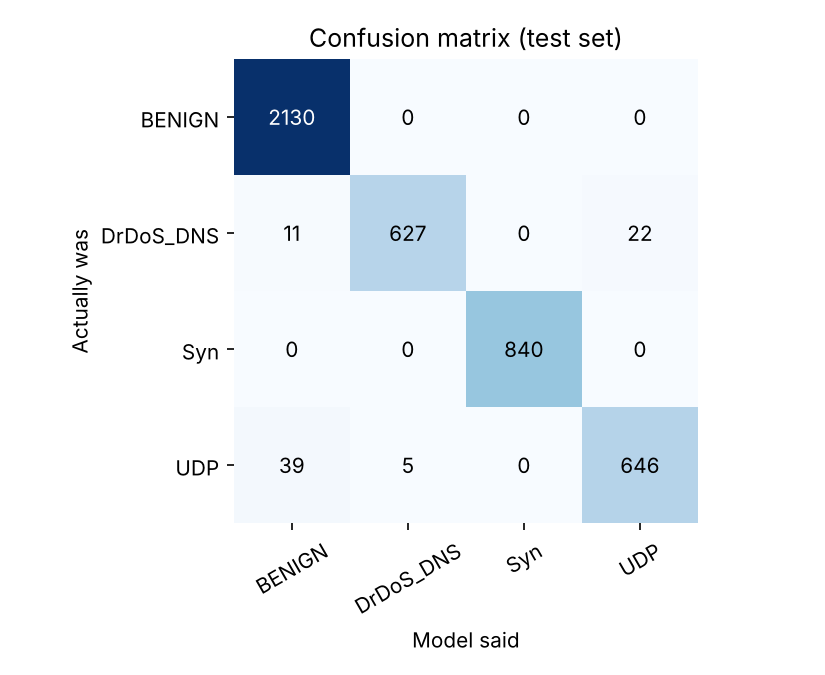
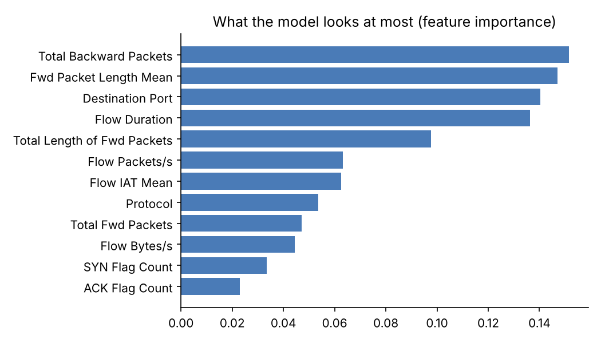

# DDoS Attack Detection – Rate Rule vs Machine Learning

**Objective.** Detect and classify DDoS attacks in network-flow data. Compare a simple firewall-style rule ("too many packets per second = attack") with a Random Forest model, and show **why** the simple rule fails.

**Certification link:** Cisco Security Core (SCOR) — DoS/DDoS Attacks, DDoS Mitigation, Network Security Visibility  
**Data science link:** Master's in Data Science — classification, feature importance, model evaluation

## TL;DR
| | 🧱 Rate rule (> 10,000 pkt/s) | 🌲 Random Forest |
| --- | --- | --- |
| Attacks caught | **28.6%** | **97.7%** |
| Attacks missed | 1,563 | 50 |
| False alarms (normal flagged as attack) | 34 | 0 |
| Can tell **which** attack? | ❌ | ✅ 98% accuracy across 4 classes |



> 💡 **Key lesson:** a SYN flood isn't one fast flow — it's **thousands of tiny flows**, each only 1–3 packets. Every single flow looks slow, so a per-flow speed rule catches **4%** of them. The model instead learns the *shape*: tiny packets, SYN flag, no reply. Same idea as fraud: one small transaction looks fine; the *pattern* gives it away.

## The 3 attacks (in plain words)
| Attack | What happens | Fingerprint in the flows | How to stop it |
| --- | --- | --- | --- |
| **SYN flood** | Attacker sends "hello" (SYN) thousands of times and never finishes the handshake. The server's waiting list fills up | Tiny packets, SYN flag = 1, almost no backward packets | SYN cookies, TCP Intercept, rate-limit new connections |
| **UDP flood** | Blast of UDP packets at random ports. Server wastes time replying "port unreachable" | One-way, many packets, random high ports | Rate-limit / police UDP, upstream filtering |
| **DNS reflection (DrDoS)** | Attacker sends small DNS queries with the **victim's IP faked** as sender. Open DNS servers send big answers to the victim | Big packets (~1,400 B) **from port 53**, one way, victim never asked | Block spoofing (uRPF / BCP 38), close open resolvers, scrubbing service, RTBH |

## Dataset
[`data/flows.csv`](./data/flows.csv) — **14,400 synthetic flows** (51% attack) built with [`generate_flows.py`](./generate_flows.py).  
It copies the **column names and behaviour** of the public [CIC-DDoS2019](https://www.unb.ca/cic/datasets/ddos-2019.html) dataset (CICFlowMeter features), and includes "hard" low-and-slow attacks that look almost normal, plus busy-but-legit traffic (video, backups) that looks fast.

> ⚠️ **Honest note:** synthetic data is cleaner than real traffic, so these scores are best-case. The script also runs on the **real** CIC-DDoS2019 CSVs — see Part C below.

**Features used (12):** protocol, destination port, flow duration, forward/backward packet counts, bytes, average packet size, bytes/s, packets/s, average time between packets, SYN and ACK flag counts.

## Method
1. **Clean:** strip column-name spaces (real CIC files have them), remove `inf`/missing values
2. **Split:** 70% train / 30% test, stratified so each attack type appears in both
3. **Baseline:** flag any flow over 10,000 packets/second
4. **Model:** Random Forest (200 trees, max depth 12) predicting the **attack type**
5. **Evaluate:** recall per attack type, false alarms, confusion matrix, feature importance

Run it yourself:
```bash
pip install pandas scikit-learn matplotlib
python detect_ddos.py
```

## Results

### Per class (Random Forest)
| Class | Precision | Recall | F1 |
| --- | --- | --- | --- |
| BENIGN | 0.977 | 1.000 | 0.988 |
| DrDoS_DNS | 0.992 | 0.950 | 0.971 |
| Syn | 1.000 | 1.000 | 1.000 |
| UDP | 0.967 | 0.936 | 0.951 |



**Reading it:** the model **never** called normal traffic an attack (top row). Its mistakes are the "low and slow" UDP and DNS attacks that look like normal DNS (left column) — exactly the traffic designed to blend in.

### What the model looks at

Top signals: **backward packets** (attacks get no reply), **average packet size** (SYN tiny, DNS reflection huge), **destination port**, and **duration**. Speed (packets/s) only ranks 6th — which is why the rate rule struggles.

## Recommended defence (layers)
1. **Edge router / firewall:** uRPF to drop spoofed sources, TCP Intercept or SYN cookies, police UDP
2. **Upstream / ISP:** scrubbing service or Remote-Triggered Black Hole for very large attacks
3. **Detection (this project):** flow-based model on NetFlow/IPFIX → alert SOC with the **attack type**, so the right mitigation is chosen fast
4. **Tune for the business:** in production, a few false alarms may be fine if it means fewer missed attacks — that's a business decision, like fraud thresholds

---

# 🔁 Redo it yourself (step by step)

**You need:** Python 3 (Jupyter or VS Code is fine). **Time:** ~2 hours.

### Part A — Understand the data (30 min)
- [ ] Open `data/flows.csv` in Excel. Filter `Label` = `Syn`. What's special about `Total Backward Packets` and `Fwd Packet Length Mean`?
- [ ] Do the same for `DrDoS_DNS`. Look at `Destination Port` and packet size
- [ ] Make a quick pivot: average of each feature by `Label`
- 🧠 **Understand:** one row = one conversation, not one packet. Write the 3 fingerprints from the table above in **your own words**

### Part B — Run + read the model (45 min)
- [ ] `python detect_ddos.py` — read the output top to bottom
- [ ] Find the line `RATE_RULE_PPS = 10_000`. Change it to `1_000`, run again
  - More attacks caught? ✅ More false alarms too? That's the **trade-off** every SOC (and fraud team) tunes
- [ ] Open the 3 charts in `img/`. Explain each one in one sentence
- [ ] Remove `"Total Backward Packets"` from `FEATURES` and rerun. How much worse does it get? Why?
- 🧠 **Understand — the 2 numbers that matter:**
  - **Recall** = of all real attacks, how many did we catch? (missed attack = outage)
  - **Precision** = of all alarms, how many were real? (false alarm = wasted analyst time)

### Part C — Try the REAL dataset (45 min, optional but impressive)
- [ ] Download CIC-DDoS2019 from the [UNB page](https://www.unb.ca/cic/datasets/ddos-2019.html) (the CSV files are large — start with one, e.g. `DrDoS_DNS.csv`)
- [ ] Take a sample so it fits in memory:
  ```python
  import pandas as pd
  pd.read_csv("DrDoS_DNS.csv", nrows=200_000).to_csv("sample.csv", index=False)
  ```
- [ ] Run `python detect_ddos.py sample.csv`
- [ ] Add a "Real data results" table to this README and compare with the synthetic results
- 🧠 Real CIC files are mostly attack traffic with few BENIGN rows. Watch the BENIGN recall — class imbalance is a real-world problem (same as rare fraud cases!)

### Finish
- [ ] Rebuild the comparison chart in Power BI from the output (bonus)
- [ ] Write "What I learned" in your own words

## What I learned
- *(write yours here)*

## Files
| File | What it is |
| --- | --- |
| [`detect_ddos.py`](./detect_ddos.py) | Rate rule + Random Forest + charts (works on real CIC CSVs) |
| [`generate_flows.py`](./generate_flows.py) | Builds the synthetic dataset |
| [`data/flows.csv`](./data/flows.csv) | Synthetic flow data |
| [`img/`](./img) | Output charts |
