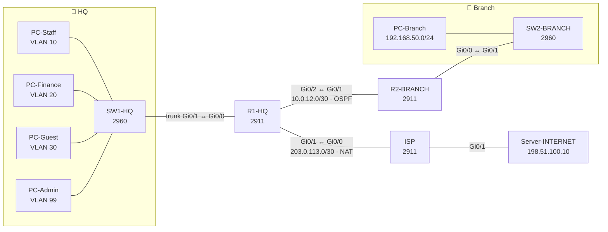

# Network Lab 01 – Secure Small Office Network (CCNA)

**Objective.** Design and build a small company network from scratch (HQ + branch + internet) and secure it with the basics every network should have.

**Certification link:** CCNA — Network Fundamentals, Network Access, IP Connectivity, IP Services, Security Fundamentals

## TL;DR
| What I built | Why a company needs it |
| --- | --- |
| 4 VLANs (Staff, Finance, Guest, Mgmt) | Keeps departments separate, so one infected PC can't reach everything |
| Router-on-a-stick | One router port routes between all VLANs |
| OSPF between HQ and branch | Routes update themselves when the network changes |
| DHCP server + relay | PCs get IPs automatically, even at the branch |
| NAT (PAT) | All private IPs share one public IP to reach the internet |
| ACLs | Guests = internet only. Finance = locked down. SSH = IT only |
| Port security + unused ports shut | Stops someone plugging in a rogue device |
| SSH v2 + login blocking | No Telnet (plain text). Blocks password guessing |

## Topology

## Addressing plan
| Network | VLAN | Subnet | Gateway | Who |
| --- | --- | --- | --- | --- |
| Staff | 10 | 192.168.10.0/24 | .1 | Normal employees |
| Finance | 20 | 192.168.20.0/24 | .1 | Sensitive — locked down |
| Guest | 30 | 192.168.30.0/24 | .1 | Visitors — internet only |
| Mgmt | 99 | 192.168.99.0/24 | .1 | IT admin, switch SVI = .2 |
| Native | 999 | — | — | Unused on purpose (stops VLAN hopping) |
| Branch LAN | — | 192.168.50.0/24 | .1 | Branch users |
| HQ ↔ Branch | — | 10.0.12.0/30 | — | R1 = .1, R2 = .2 |
| HQ ↔ ISP | — | 203.0.113.0/30 | — | ISP = .1, R1 = .2 |
| "Internet" | — | 198.51.100.0/24 | .1 | Web + DNS server = .10 |

> IPs `203.0.113.x` and `198.51.100.x` are reserved documentation ranges (RFC 5737), not real addresses.

## Security decisions (and why)
| Control | Where | Why |
| --- | --- | --- |
| `GUEST-IN` ACL | R1 Gi0/0.30 **in** | Guests can reach the internet but **no** internal network. Filter close to the source. |
| `FINANCE-OUT` ACL | R1 Gi0/0.20 **out** | Only IT can *start* a connection to Finance. Finance can still reach others (replies are allowed back). |
| `MGMT-ONLY` + `transport input ssh` | All VTY lines | Only the IT VLAN can log in to devices, and only with encrypted SSH. |
| `login block-for 120 attempts 3 within 60` | R1 | 3 wrong passwords in 60 s → logins blocked for 2 min (stops brute-force). |
| Port security (sticky MAC) | SW1/SW2 access ports | Remembers the first device. A different device = alert (Staff) or port shut (Finance). |
| Native VLAN 999 + unused ports shut | SW1 | Removes easy attack paths (VLAN hopping, plugging into a spare port). |
| BPDU guard + PortFast | Access ports | A user plugging in a switch can't hijack spanning tree. |

## Test results (what should happen)
| # | Test | Expected | Proves |
| --- | --- | --- | --- |
| 1 | PC-Staff → `ping 198.51.100.10` | ✅ Reply | Routing + NAT work |
| 2 | PC-Staff browser → `http://www.portfolio.lab` | ✅ Page loads | DNS + NAT work |
| 3 | PC-Branch gets IP `192.168.50.11+` | ✅ | DHCP relay works across OSPF |
| 4 | PC-Guest → `ping 192.168.10.11` | ❌ Fails | Guest isolation |
| 5 | PC-Guest → `ping 198.51.100.10` | ✅ Reply | Guests still have internet |
| 6 | PC-Staff → `ping 192.168.20.11` (Finance) | ❌ Fails | Finance protected |
| 7 | PC-Finance → `ping 192.168.10.11` (Staff) | ✅ Reply | Finance can still work normally |
| 8 | PC-Admin → `ssh -l admin 192.168.99.1` | ✅ Login | Mgmt access works |
| 9 | PC-Staff → `ssh -l admin 192.168.10.1` | ❌ Refused | Only IT can manage devices |
| 10 | Swap PC-Finance for a new PC on Fa0/6 | ❌ Port goes err-disabled | Port security works |

📸 *Add your screenshots of each test here as you complete them.*

---

# 🔁 Redo it yourself (step by step)

**You need:** Cisco Packet Tracer (free with a [Cisco NetAcad](https://www.netacad.com/) account). **Time:** ~2–3 hours. Do one phase per sitting if you want.

**How to use the config files:** open a device → CLI tab → copy-paste one *section* at a time (not the whole file), then run the check under each step. Typing it yourself is even better for learning.

### Phase 1 — Build the picture (20 min)
- [ ] Add devices: 3 × **2911** routers (R1-HQ, R2-BRANCH, ISP), 2 × **2960** switches, 5 PCs, 1 Server
- [ ] Cable them using **Copper Straight-Through**, matching the port names in the topology above
- [ ] Rename every device (click it → Config tab → Display Name)
- ✅ **Check:** all cables exist. Links will stay red until you configure them — that's normal

### Phase 2 — VLANs + trunk (20 min) → `SW1-HQ.txt` sections 1–2
- [ ] Create VLANs 10, 20, 30, 99, 999
- [ ] Make Gi0/1 a trunk with native VLAN 999
- ✅ **Check:** `show vlan brief` (VLANs listed) and `show interfaces trunk` (Gi0/1 trunking)
- 🧠 **Understand:** a trunk carries many VLANs on one cable by adding a tag (802.1Q) to each frame

### Phase 3 — Router-on-a-stick (15 min) → `R1-HQ.txt` section 2
- [ ] Bring Gi0/0 up, then create one subinterface per VLAN
- ✅ **Check:** `show ip interface brief` — every `Gi0/0.x` is **up/up**
- 🧠 **Understand:** `encapsulation dot1Q 10` = "this subinterface handles frames tagged VLAN 10"

### Phase 4 — Access ports (15 min) → `SW1-HQ.txt` sections 3–5
- [ ] Put PCs in their VLANs, turn on port security, shut unused ports
- ✅ **Check:** `show vlan brief` — ports appear under the right VLAN

### Phase 5 — DHCP (15 min) → `R1-HQ.txt` section 4
- [ ] Create pools + excluded addresses
- [ ] On each HQ PC: Desktop → IP Configuration → **DHCP**
- [ ] **Except PC-Admin:** give it a static IP `192.168.99.10 /24`, gateway `192.168.99.1` (no DHCP pool for Mgmt on purpose — IT devices get fixed IPs)
- ✅ **Check:** PCs get `192.168.x.11` or higher. On R1: `show ip dhcp binding`
- 🧠 **Understand:** we exclude .1–.10 so they're free for routers, printers and servers

### Phase 6 — WAN + OSPF (25 min) → `R1-HQ.txt` sections 3, 5 · `R2-BRANCH.txt` · `ISP.txt`
- [ ] Configure IPs on the R1–R2 and R1–ISP links
- [ ] Turn on OSPF on R1 and R2
- [ ] Set up the Server (IP, HTTP on, DNS record)
- [ ] Branch PC → DHCP
- ✅ **Check:** `show ip ospf neighbor` → **FULL** · `show ip route` on R2 has `O` routes and an `O*E2` default route · Branch PC gets `192.168.50.x`
- 🧠 **Understand:** `ip helper-address` turns the branch PC's DHCP *broadcast* into a *unicast* sent to R1, because broadcasts can't cross routers

### Phase 7 — NAT (10 min) → `R1-HQ.txt` section 6
- [ ] Mark inside/outside interfaces, add the NAT rule
- ✅ **Check:** PC-Staff pings `198.51.100.10` ✅ then on R1: `show ip nat translations`
- 🧠 **Understand:** ISP has *no route* to 192.168.x.x. NAT swaps your private IP for `203.0.113.2` so the reply can come back. Try removing NAT — the ping fails. That's the proof

### Phase 8 — ACLs (25 min) → `R1-HQ.txt` sections 7–8
- [ ] **Before** adding ACLs, ping Guest → Staff. It works (that's the problem!)
- [ ] Add `GUEST-IN` and `FINANCE-OUT`
- [ ] Run tests 4–7 from the table above
- ✅ **Check:** `show access-lists` — match counters go up as you test
- 🧠 **Understand:** ACLs read **top to bottom** and stop at the first match. There's a hidden `deny any` at the end — that's why each ACL finishes with a `permit`

### Phase 9 — Hardening (15 min) → `R1-HQ.txt` sections 1, 9 (+ same on switches)
- [ ] Add passwords, SSH, VTY restrictions
- ✅ **Check:** tests 8–9. Then type the wrong password 3 times — you get blocked
- 🧠 **Understand:** Telnet sends passwords in plain text. Prove it later with Wireshark if you want a bonus screenshot

### Phase 10 — Break it on purpose (10 min) 🔨
- [ ] Unplug PC-Finance, plug a new PC into Fa0/6 → `show port-security interface fa0/6` (err-disabled)
- [ ] Fix it: `shutdown` then `no shutdown` on the port
- 🧠 **Understand:** this is exactly how a real help-desk ticket "my network port died" happens

### Phase 11 — Save + document
- [ ] `write memory` on every device
- [ ] Save the `.pkt` file into this folder
- [ ] Screenshot each test and add it above
- [ ] Write 3 lines in "What I learned" below in **your own words**

## 🛠️ Troubleshooting cheat sheet
| Problem | Check |
| --- | --- |
| PC gets `169.254.x.x` | DHCP failed → wrong VLAN on port? trunk down? `show ip dhcp pool` |
| Subinterface down | Is the physical `Gi0/0` `no shutdown`? |
| No OSPF neighbor | Same subnet? Link up? `no passive-interface` on the link? |
| Ping to internet fails | `show ip nat translations` empty → check `ip nat inside/outside` |
| ACL blocks too much | `show access-lists` → which line is counting matches? |

## What I learned
- *(write yours here)*

## Files
| File | Device |
| --- | --- |
| [`configs/R1-HQ.txt`](./configs/R1-HQ.txt) | HQ router — routing, DHCP, NAT, ACLs |
| [`configs/R2-BRANCH.txt`](./configs/R2-BRANCH.txt) | Branch router — OSPF, DHCP relay |
| [`configs/ISP.txt`](./configs/ISP.txt) | Simulated internet + server setup |
| [`configs/SW1-HQ.txt`](./configs/SW1-HQ.txt) | HQ switch — VLANs, trunk, port security |
| [`configs/SW2-BRANCH.txt`](./configs/SW2-BRANCH.txt) | Branch switch |
