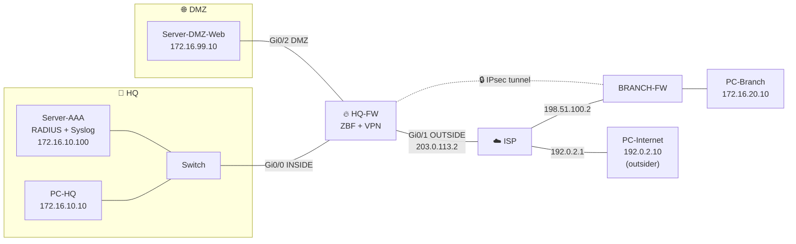

# Network Lab 02 – Zone-Based Firewall + Site-to-Site VPN (CCNP Security)

**Objective.** Protect a head office with a firewall that has 3 security zones, publish one web server safely, and connect a branch office through an encrypted IPsec tunnel. Admin logins go through a central RADIUS server, and firewall drops are sent to a syslog server.

**Certification link:** CCNP Security / SCOR — Firewalls, VPNs, Secure Network Access, AAA, Visibility & Enforcement

## TL;DR
| What I built | Why a company needs it |
| --- | --- |
| **Zone-Based Firewall** (INSIDE / OUTSIDE / DMZ) | Default = block. Only traffic I allow passes, and replies are tracked (stateful) |
| **DMZ** for the public web server | If the server is hacked, it **cannot** reach the office LAN |
| **Port forward only TCP 80** | The internet sees one port, not the whole server |
| **Site-to-site IPsec VPN** (AES-256) | Branch ↔ HQ traffic crosses the internet encrypted |
| **NAT exemption** | Stops NAT from breaking the VPN (a classic real-world mistake) |
| **AAA with RADIUS** | One central place to add/remove admin accounts, with local fallback |
| **Syslog** | Every dropped connection is logged → a SOC can see it |

## Topology

## Firewall policy (who can talk to whom)
| From ↓ / To → | INSIDE | DMZ | OUTSIDE |
| --- | --- | --- | --- |
| **INSIDE** | — | ✅ web, DNS, ping | ✅ web, DNS, ping + VPN to branch |
| **DMZ** | ❌ **blocked** | — | ❌ **blocked** |
| **OUTSIDE** | ✅ only Branch via VPN | ✅ only TCP 80 to web server | — |

> 💡 **Why block DMZ → OUTSIDE?** A hacked server usually "calls home" to the attacker (reverse shell). No outbound rule = that call never connects.

## VPN settings
| Phase | Setting | Value |
| --- | --- | --- |
| 1 (IKE) | Encryption / Hash | AES-256 / SHA |
| 1 (IKE) | Authentication | Pre-shared key |
| 1 (IKE) | DH group / Lifetime | 5 / 24 h |
| 2 (IPsec) | Transform set | ESP-AES-256 + ESP-SHA-HMAC |
| 2 (IPsec) | Protected traffic | 172.16.10.0/24 ↔ 172.16.20.0/24 |

> ⚠️ **Lab vs real world:** Packet Tracer only supports IKEv1 and older DH groups. In production I would use **IKEv2**, **DH group 19/20+**, **PFS**, and **certificates** instead of a pre-shared key.

## Test results (what should happen)
| # | Test | Expected | Proves |
| --- | --- | --- | --- |
| 1 | PC-HQ → `ping 172.16.20.10` (Branch) | ✅ (1st ping may time out while the tunnel builds) | VPN works |
| 2 | HQ-FW: `show crypto isakmp sa` | State `QM_IDLE` | Phase 1 is up |
| 3 | HQ-FW: `show crypto ipsec sa` | `#pkts encaps/decaps` increase | Traffic is encrypted |
| 4 | Simulation mode: watch the ping on the ISP link | Packet shows **ESP**, not ICMP | ISP can't read it |
| 5 | PC-HQ → `ping 192.0.2.10` | ✅ | Inside → internet allowed |
| 6 | PC-Internet browser → `http://203.0.113.2` | ✅ DMZ page loads | Port forward + DMZ rule |
| 7 | PC-Internet → `ping 172.16.10.10` | ❌ | Inside is hidden |
| 8 | Server-DMZ-Web → `ping 172.16.10.10` | ❌ | DMZ can't attack inside |
| 9 | PC-HQ → `ssh -l netadmin 172.16.10.1` | ✅ login with RADIUS user | AAA works |
| 10 | Server-AAA → Syslog tab | Drop messages appear | SOC visibility |

📸 *Add your screenshots of each test here as you complete them.*

---

# 🔁 Redo it yourself (step by step)

**You need:** Cisco Packet Tracer. Finish Lab 01 first (same basics). **Time:** ~3 hours.

### Phase 1 — Build + address (25 min) → `ISP-and-hosts.txt`
- [ ] Devices: 3 × **2911** (HQ-FW, BRANCH-FW, ISP), 1 × 2960 switch at HQ, 3 PCs, 2 Servers
- [ ] Cable them as in the topology. **2911 has 3 Gi ports** — Gi0/2 on HQ-FW goes to the DMZ server
- [ ] Configure ISP and give all end devices static IPs
- ✅ **Check:** PC-Internet can ping `192.0.2.1`

### Phase 2 — License + interfaces + routes (20 min) → `HQ-FW.txt` sections 0–1, top of `BRANCH-FW.txt`
- [ ] Turn on `securityk9`, `write memory`, `reload`
- [ ] Configure interfaces and the default route
- ✅ **Check:** `show version` lists **securityk9**. HQ-FW can ping `198.51.100.2`
- 🧠 **Understand:** firewall and VPN commands are hidden until this license is on

### Phase 3 — NAT (15 min) → section 2 (both firewalls)
- [ ] Add the NAT ACL **with the deny line first**, plus the static port-forward on HQ
- ✅ **Check:** PC-HQ pings `192.0.2.10` ✅ · `show ip nat translations`
- 🧠 **Understand:** NAT happens **before** encryption. If HQ→Branch traffic were NATed to `203.0.113.2`, it would no longer match the VPN ACL and would go out unencrypted (and fail). The `deny` line = "don't NAT this"

### Phase 4 — VPN (30 min) → section 3 (both firewalls)
- [ ] Configure HQ, then Branch. Copy carefully — the settings **must match** on both ends
- [ ] Ping PC-Branch from PC-HQ (it's OK if the first one or two time out)
- ✅ **Check:** tests 1–4 in the table
- 🧠 **Understand:**
  - **Phase 1** = the two firewalls shake hands and agree how to talk safely
  - **Phase 2** = the actual data tunnel
  - The **crypto ACL** decides which traffic goes into the tunnel. Branch's ACL is the **mirror** of HQ's

### Phase 5 — Zone-Based Firewall (40 min) → section 4
- [ ] **Before** ZBF, test: Server-DMZ-Web → `ping 172.16.10.10` **works** (that's the problem! A hacked web server could reach your office)
- [ ] Build in this order: **zones → interfaces into zones → class-maps → policy-maps → zone-pairs**
- [ ] Run tests 5–8
- ✅ **Check:** `show zone-pair security` · `show policy-map type inspect zone-pair sessions`
- 🧠 **Understand — remember it as "W-H-W":**
  - **class-map = WHAT** traffic (http, dns, an ACL)
  - **policy-map = HOW** to treat it (`inspect` = allow + track the reply, `drop`, `pass`)
  - **zone-pair = WHERE** (direction: from zone → to zone)
- 🧠 Traffic between zones with **no zone-pair is dropped**. Traffic to/from the router itself (the "self" zone) is allowed by default — that's why the VPN and RADIUS still work

### Phase 6 — AAA with RADIUS (20 min) → section 5
- [ ] On Server-AAA: turn on AAA, add client `HQ-FW` and user `netadmin`
- [ ] Configure AAA on HQ-FW
- [ ] **Keep the console on `local`** so you can't lock yourself out
- ✅ **Check:** test 9. Then turn the AAA service **off** on the server → login with `localadmin` still works (fallback)
- 🧠 **Understand:** with 50 routers, you'd change one password on the RADIUS server — not 50 times

### Phase 7 — Syslog (10 min) → section 6
- [ ] Turn on Syslog on Server-AAA, add `logging host`
- [ ] Try test 7 or 8 again
- ✅ **Check:** Server-AAA → Services → SYSLOG shows drop messages
- 🧠 **Understand:** these logs are what a SIEM (e.g. Splunk) collects. Your log-analysis project shows what happens next

### Phase 8 — Break it on purpose 🔨 (15 min)
- [ ] Change the VPN key on Branch only → tunnel fails. Run `debug crypto isakmp` and read the error. Fix it
- [ ] Remove the `deny` line from `NAT-HQ` → VPN ping fails. Put it back
- 🧠 **Understand:** these are the two most common reasons real VPNs "don't come up"

### Phase 9 — Save + document
- [ ] `write memory` everywhere, save the `.pkt` here
- [ ] Screenshot tests 1–10 (Simulation-mode ESP packet = great screenshot)
- [ ] Bonus: add a ZBF to BRANCH-FW yourself
- [ ] Write "What I learned" in your own words

## 🛠️ Troubleshooting cheat sheet
| Problem | Check |
| --- | --- |
| `zone security` command not found | License not active → `show version`, reload |
| No ISAKMP SA | Key / peer IP / policy mismatch → `debug crypto isakmp` |
| ISAKMP up but no traffic | Crypto ACLs not mirrored, or NAT exemption missing |
| Everything blocked after ZBF | Interface not in a zone? Missing zone-pair? |
| RADIUS login fails | Secret mismatch, wrong client IP (must be `172.16.10.1`) |

## What I learned
- *(write yours here)*

## Files
| File | Device |
| --- | --- |
| [`configs/HQ-FW.txt`](./configs/HQ-FW.txt) | ZBF, VPN, NAT, AAA, syslog |
| [`configs/BRANCH-FW.txt`](./configs/BRANCH-FW.txt) | VPN peer + NAT |
| [`configs/ISP-and-hosts.txt`](./configs/ISP-and-hosts.txt) | ISP router + all end-device settings |
