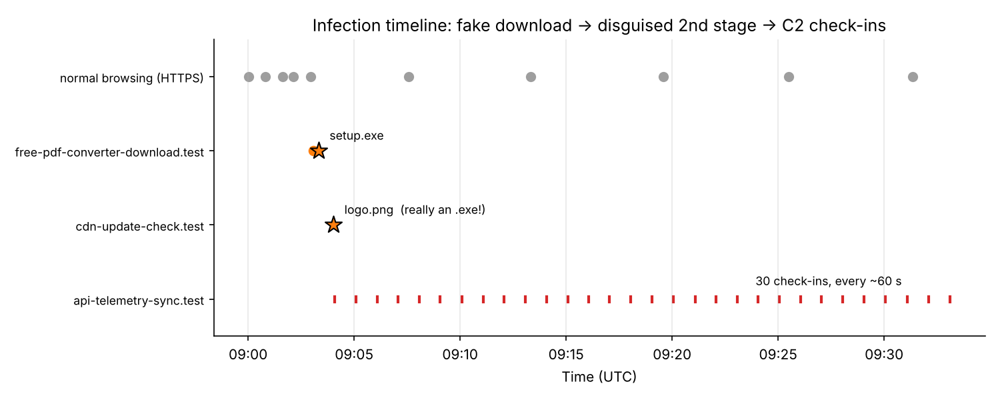
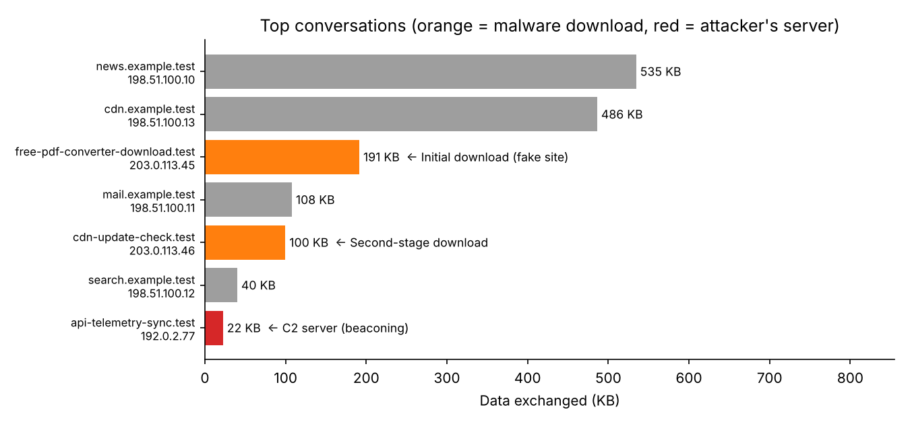
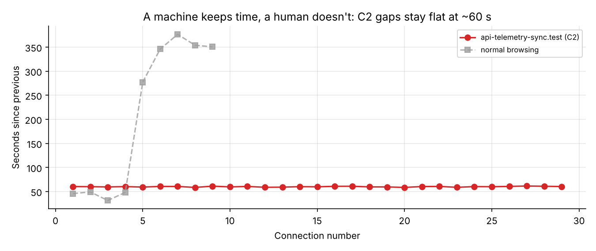

# PCAP Analysis – "It's a Trap!" (Fake Software Download → Malware)

**Objective.** Follow one infected PC through its network traffic: how it got infected, what it downloaded, and who it's talking to now — first by hand in **Wireshark**, then automated in **Python**.

**The story in one line:** a user looks for a *free PDF converter*, lands on a **fake download site**, runs `setup.exe`, and the PC starts **checking in with an attacker's server every 60 seconds**.

## TL;DR
| Step | What happened | Clue in the traffic |
| --- | --- | --- |
| 1️⃣ **Lure** | User visits `free-pdf-converter-download.test` | Plain **HTTP** (no padlock) on an unknown "free software" domain |
| 2️⃣ **Download** | `setup.exe` downloaded (184 KB) | File starts with **`MZ`** = a Windows program |
| 3️⃣ **Second stage** | `logo.png` downloaded 43 s later | Called an *image*, but also starts with **`MZ`** → a **disguised program** 🚩 |
| 4️⃣ **Command & control (C2)** | 30 × `POST /gate.php` to `api-telemetry-sync.test` | Every **60.1 s ± 0.8 s**, with an outdated **IE8** browser name → a bot, not a person |

> 💡 **Volume isn't risk (again).** The attacker's server is the **smallest** conversation in the whole capture (22 KB) but has the **most connections** (30). Sorting Wireshark's *Conversations* by bytes alone puts it at the bottom.

---

## Part 1 — The original exercise (Wireshark)
My first pass on the malware-traffic-analysis.net exercise *"It's a trap!" (2018-07-20)*:

1. Opened the PCAP in Wireshark
2. **Statistics → Protocol Hierarchy** — saw abnormal DNS & HTTP traffic
3. **Statistics → Conversations** — one external IP dominated traffic
4. **Follow → TCP Stream** — found an HTTP `GET` request downloading `setup.exe`

**Findings:** multiple DNS queries to suspicious domains · an HTTP download of an executable file · likely malware delivery from a fake software site.


The original PCAP isn't stored here (the site shares it password-protected, and it contains real malware traffic). So in Part 2 I rebuilt the same kind of attack as a **safe, reproducible lab** — and took it further.

---

## Part 2 — The reproducible lab (Python)

### Dataset
[`data/trap-lab.pcap`](./data/trap-lab.pcap) — **synthetic**, built by [`generate_pcap.py`](./generate_pcap.py) · 1,811 packets · 12 Nov 2026, 09:00–09:33 UTC · opens in Wireshark.

- ✅ **Safe:** every "file" is random bytes. `setup.exe` only *starts* like a Windows program so the checks have something to find — nothing can run.
- IPs are documentation ranges (RFC 5737); domains end in `.test` (RFC 2606). None are real.
- Includes normal HTTPS browsing so the attack has to be **found**, not just read.

### Method — 6 steps (the same in Wireshark and Python)
| # | Question | Wireshark | Python (`analyze.py`) |
| --- | --- | --- | --- |
| 1 | **Which PC** is infected? | filter `dhcp` → hostname, MAC | reads the DHCP hostname |
| 2 | What's **in** the capture? | Statistics → Protocol Hierarchy | counts packets/bytes per protocol |
| 3 | Who **talks** the most? | Statistics → Conversations | ranks TCP conversations by bytes |
| 4 | Was a **program downloaded**? | filter `frame contains "This program cannot be run in DOS mode"` · File → Export Objects → HTTP | rebuilds each HTTP stream, checks if the body starts with `MZ`, and flags files whose **name says otherwise** |
| 5 | Is anything **beaconing**? | filter `http.request.method == "POST"` → Statistics → Conversations | same server + same request, **6+ times**, gaps **≤ 10% apart** (std ÷ mean) |
| 6 | **Timeline + IOCs** | filter `dns.flags.response == 1` | joins DNS names → IPs → roles, first/last seen |

Run it:
```bash
pip install scapy pandas matplotlib
python generate_pcap.py      # builds data/trap-lab.pcap
python analyze.py            # runs the 6 steps + makes the charts
python analyze.py other.pcap # try it on another capture
```

### Findings

**1. The infected host**
| Hostname | IP | MAC |
| --- | --- | --- |
| `DESKTOP-TRAP01` | `10.7.20.101` | `00:1e:4f:7a:20:18` |

**2. 🟠 The lure — fake download site (09:03)**
- `GET http://free-pdf-converter-download.test/` then `/download/setup.exe` (184,105 bytes, `application/octet-stream`).
- Served over plain **HTTP**. Real software vendors use HTTPS.

**3. 🟠 The disguise — second stage (09:04)**
- 43 seconds later the PC fetches `http://cdn-update-check.test/img/logo.png` — labelled `image/png`, but the first bytes are **`MZ`**.
- A file that lies about what it is = **almost always malicious**. This is exactly what *Export Objects* + checking file headers catches.

**4. 🔴 The attacker's line — C2 beaconing (09:04 → 09:33)**
- **30** `POST /gate.php` requests to `api-telemetry-sync.test` (`192.0.2.77`).
- Average gap **60.1 s**, std dev **0.8 s** → a timer, not a human.
- Each check-in sends the **hostname** (`id=DESKTOP-TRAP01&os=win10…`), and the server sometimes replies with a command (`CMD:sleep 60`).
- User-Agent is **Internet Explorer 8 on Windows 7** — on a Windows 10 PC that otherwise uses Chrome. Malware often hard-codes an old browser name.

### Indicators of compromise (IOCs)
| Domain | IP | Role | Requests | First seen | Last seen |
| --- | --- | --- | --- | --- | --- |
| `free-pdf-converter-download.test` | `203.0.113.45` | Initial download (fake site) | 2 | 09:03:04 | 09:03:18 |
| `cdn-update-check.test` | `203.0.113.46` | Second-stage download | 1 | 09:04:01 | 09:04:01 |
| `api-telemetry-sync.test` | `192.0.2.77` | C2 server (beaconing) | 30 | 09:04:04 | 09:33:06 |

Other IOCs: URL path `/gate.php` · User-Agent `Mozilla/4.0 (compatible; MSIE 8.0; Windows NT 6.1)`

### Charts
**The whole attack on one timeline:**


**Top conversations — the attacker's server is the smallest bar:**


**A machine keeps time, a human doesn't:**


### Recommended Response
1. **Isolate** `DESKTOP-TRAP01` from the network (it's taking orders from the attacker).
2. **Block** the 3 domains and IPs at the firewall / web proxy / DNS.
3. **Hunt:** search proxy and DNS logs for any **other** PC talking to these IOCs.
4. **Re-image** the PC; reset passwords used on it (the malware may have stolen them).
5. **Prevent:** block `.exe` downloads from uncategorised sites, and only allow software from an approved catalogue.

### Detection ideas (SOC-style)
**Wireshark display filters**
```text
dhcp                                              # who is this PC?
http.request                                      # every web request in plain text
frame contains "This program cannot be run in DOS mode"   # Windows programs being downloaded
http.request.method == "POST" and http.request.uri contains ".php"
http.user_agent contains "MSIE"                   # outdated browser names
```

**Splunk (conceptual) — executable disguised as something else**
```splunk
index=proxy file_magic="MZ" NOT uri_path IN ("*.exe","*.msi","*.dll")
| table _time src_ip url content_type bytes
```

**Splunk (conceptual) — beaconing**
```splunk
index=proxy http_method=POST
| sort 0 _time
| streamstats current=f last(_time) as prev by src_ip, dest_host
| eval gap=_time-prev
| stats count avg(gap) as avg_gap stdev(gap) as sd by src_ip, dest_host
| where count>=6 AND sd/avg_gap<=0.1
```

---

# 🔁 Redo it yourself (step by step)

**You need:** Python 3 and **Wireshark** (free). **Time:** Part A ~1 h, Part B ~1 h.

### Part A — By hand in Wireshark (1 h)
- [ ] Run `python generate_pcap.py`, then open `data/trap-lab.pcap` in Wireshark
- [ ] Filter `dhcp` → open the packet → find **hostname, IP, MAC** (Option 12 = hostname)
- [ ] **Statistics → Protocol Hierarchy** → how much is HTTP vs HTTPS?
- [ ] **Statistics → Conversations → IPv4** → sort by **Bytes**, then by **Packets**. Which server jumps up the list? Why?
- [ ] Filter `http.request` → write down every domain + path
- [ ] **File → Export Objects → HTTP** → look at `setup.exe` and `logo.png`. Right-click a `logo.png` packet → **Follow → TCP Stream** → the body starts with `MZ`
- [ ] Filter `http.request.method == "POST"` → open 3 packets in a row. Note the **times** and the **User-Agent**
- ✅ **Check:** you can fill the IOC table above from Wireshark alone
- 🧠 **Understand:** why is a `.png` starting with `MZ` a stronger alarm than an `.exe` starting with `MZ`?

### Part B — Automate it in Python (1 h)
- [ ] Run `python analyze.py` and read the output **one step at a time**
- [ ] For each step, find its block in `analyze.py` and explain it in one sentence:
  - **Step 4** → *"glue the TCP pieces back together, skip the headers, look at the first 2 bytes"*
  - **Step 5** → *"same server, same request, gaps that barely change = a timer"*
- [ ] Open the 3 charts in `img/`
- [ ] **Change one setting** (e.g. `BEACON_MAX_CV = 0.005`) and run again. Does the C2 still get caught? Why not?
- 🧠 **Fraud link:** beaconing is like a card being charged **exactly** RM 9.90 every 60 seconds. No human pays like that — the rhythm itself is the alarm.

### Part C — Make it yours (optional)
- [ ] In `generate_pcap.py`, add **jitter** to the beacon (e.g. `random.uniform(-20, 20)`). Can `analyze.py` still catch it? What would you change?
- [ ] Try `python analyze.py` on a real exercise PCAP from malware-traffic-analysis.net (inside a VM — never on your main PC)

### Finish
- [ ] Add your own Wireshark screenshots of Part A here
- [ ] Write "What I learned" in your own words

## What I learned
- *(write yours here)*

## Files
| File | What it is |
| --- | --- |
| [`generate_pcap.py`](./generate_pcap.py) | Builds the safe synthetic capture |
| [`data/trap-lab.pcap`](./data/trap-lab.pcap) | The capture — open in Wireshark |
| [`analyze.py`](./analyze.py) | 6-step triage + charts (works on other PCAPs) |
| [`img/`](./img) | Output charts |
